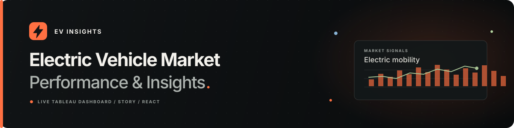

  

  <a href="https://darshilparikh24-beep.github.io/EV-Market-Analysis-Tableau/">Live website</a>
  &nbsp;·&nbsp;
  <a href="https://public.tableau.com/views/EV_Market_Performance_Insights_Story_Final/ElectricVehicleMarketPerformanceInsights">Tableau dashboard</a>
  &nbsp;·&nbsp;
  <a href="https://public.tableau.com/views/EV_Market_Performance_Insights_Story_Final/EVMarketExecutiveStory">Tableau story</a>

# EV Insights

**Electric Vehicle Market Performance & Insights** is a responsive project site for exploring the published EV market dashboard and its companion Tableau story. A charcoal canvas, electric-orange highlights, and chart-inspired details carry the website’s visual theme into this project README.

## Live project

| Explore | Open |
| --- | --- |
| EV Insights website | [Live site](https://darshilparikh24-beep.github.io/EV-Market-Analysis-Tableau/) |
| Interactive Tableau dashboard | [Electric Vehicle Market Performance & Insights](https://public.tableau.com/views/EV_Market_Performance_Insights_Story_Final/ElectricVehicleMarketPerformanceInsights) |
| Tableau story | [EV Market Executive Story](https://public.tableau.com/views/EV_Market_Performance_Insights_Story_Final/EVMarketExecutiveStory) |
| Source repository | [EV-Market-Analysis-Tableau](https://github.com/darshilparikh24-beep/EV-Market-Analysis-Tableau) |

## What you can explore

- **Dashboard:** use the published Tableau filters and views for category, manufacturer, region, battery technology, customer rating, range, and manufacturing locations.
- **Story:** follow the executive story included in the published workbook.
- **Analysis guide:** browse descriptions of analysis areas and questions to consider while using the views.
- **Project method:** see how the workbook, story, site, and GitHub Pages deployment fit together.

The site embeds the existing Tableau workbook; it does not redraw charts or invent market statistics. Explanatory cards describe what visitors can explore and are not additional dataset findings.

## Design and accessibility

The site uses a dark charcoal palette with electric-orange accents, muted green and blue chart details, responsive layouts, and lightweight motion. It includes semantic sections, keyboard focus styles, a skip link, mobile navigation, and reduced-motion support.

## Technology

- React and JavaScript
- Vite and custom responsive CSS
- Tableau Embedding API v3
- GitHub Actions and GitHub Pages
- pnpm

There is no Flask or database backend in this repository. GitHub Pages serves the static site; Tableau Public serves the interactive views.

## Run locally

**Requirements:** Node.js 22.12 or newer and pnpm 11.25.0.

~~~bash
pnpm install
pnpm dev
~~~

Open the local URL shown by Vite. To create and preview a production build:

~~~bash
pnpm build
pnpm preview
~~~

## Tableau links

Both view URLs are configured in **src/config/tableau.js**. The Story is the **EVMarketExecutiveStory** view in the published **EV_Market_Performance_Insights_Story_Final** workbook.

The Tableau views and embedded extract are public. Visitors need an internet connection to load them. If an embed cannot load, the site provides a direct link to Tableau Public.

## Data notes

The published Tableau workbook contains an embedded **EV_Market_Data.hyper** extract. Its schema includes vehicle and market fields such as **manufacturer**, **model_year**, **manufacturing_country**, and **market_region**; vehicle measures such as **range_km**, **price_usd**, and **annual_sales_units**; and technical or experience measures such as **battery_capacity_kwh**, **battery_type**, **efficiency_wh_per_km**, and **customer_rating**.

This website does not bundle a source CSV or create its own numerical analysis. Use the interactive Tableau views to inspect the workbook’s data and measures.

## Project structure

~~~text
.
├── .github/workflows/deploy.yml
├── public/
│   ├── .nojekyll
│   ├── ev-insights-readme-banner.svg
│   └── favicon.svg
├── src/
│   ├── components/
│   ├── config/tableau.js
│   ├── App.jsx
│   ├── main.jsx
│   └── styles.css
├── index.html
├── package.json
├── pnpm-lock.yaml
└── vite.config.js
~~~

## GitHub Pages deployment

The **Deploy EV Insights to GitHub Pages** workflow builds on pushes to **main**, then publishes the **dist/** directory. Vite reads **GITHUB_REPOSITORY** to set the project-page asset paths.

For a new repository, choose **Settings → Pages → Build and deployment → GitHub Actions**. This project is live at:

**https://darshilparikh24-beep.github.io/EV-Market-Analysis-Tableau/**

## Limitations

- The interactive dashboard and story are hosted by Tableau Public and depend on its availability.
- GitHub Pages serves static files; this site has no server-side processing or user accounts.
- The repository does not include the workbook’s source CSV.

## License

No software or data license is declared in this repository yet. Check the Tableau workbook’s source-data terms before redistributing its extract.
